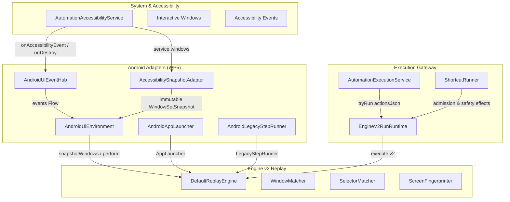

# Engine v2 Android Adapter & Replay Runtime (WP5)

## Overview

Work Package 5 connects the pure-Kotlin Engine v2 replay state machine (`DefaultReplayEngine`) to the live Android accessibility subsystem, app launcher, legacy step execution, and foreground service lifecycle.

The architecture ensures strict boundary isolation:
1. Platform `AccessibilityNodeInfo` objects are never retained across replay waits or state transitions.
2. The engine interacts purely with immutable `WindowSetSnapshot` trees and `UiEnvironment`.
3. Dispatched gestures, semantic accessibility actions, and global actions are verified through postcondition re-snapshots rather than trusting immediate framework return codes.

---

## Component Architecture

### 1. `AccessibilitySnapshotAdapter`
- **Role**: Implements `WindowSnapshotSource`.
- **Traversal**: Walks `service.windows` in descending layer order. Extracts each window root into an immutable `WindowSnapshot` and `NodeSnapshot` hierarchy.
- **Node IDs**: Generates globally unique sequential integer IDs (1..N) across all windows in a snapshot. Each published snapshot also has an adapter-local generation; node IDs are valid only with that generation and are never carried into a later snapshot.
- **Caps & Safeguards**: Bounded at 3000 nodes total and depth 60 per snapshot to eliminate memory bloat on large web views or list hierarchies.
- **Recycling**: Calls `safeRecycle()` on every platform `AccessibilityNodeInfo` obtained during traversal on API < 33.
- **Live Node Re-resolution**: Maintains a generation-scoped map `nodeId -> NodeLocator(windowId, childPath)` storing the zero-based child index path from the root. `AndroidUiEnvironment` rejects an action unless its request generation is still current, then validates the re-resolved node's class, resource ID, package, and any selector text/description identity before dispatch. This prevents an inserted row from reusing an old ID to target a different control.
- **Thread contract**: Snapshot creation may run from a background worker. Publication and generation/locator state are synchronized; callers only receive immutable values and no Android node is retained across calls. The adapter deliberately uses no main-thread-only API.
- **Registration**: Registered in `EngineV2.snapshotSource` in `AutomationAccessibilityService.onServiceConnected` and cleared in `onDestroy`.

### 2. `AndroidUiEnvironment`
- **Role**: Concrete `UiEnvironment` adapter for the replay engine.
- **Events**: Exposed via `AndroidUiEventHub`, fed from `AutomationAccessibilityService.onAccessibilityEvent` and `onDestroy`:
  - `TYPE_WINDOW_STATE_CHANGED`, `TYPE_WINDOWS_CHANGED` -> `UiEnvironmentEvent.WindowsChanged`
  - `TYPE_WINDOW_CONTENT_CHANGED`, `TYPE_VIEW_SCROLLED` -> `UiEnvironmentEvent.ContentChanged`
  - `TYPE_VIEW_FOCUSED` -> `UiEnvironmentEvent.FocusChanged`
  - Service `onDestroy` -> `UiEnvironmentEvent.AccessibilityDisconnected`
- **Observed Activity**: Tracks the latest Activity className seen per package via `TYPE_WINDOW_STATE_CHANGED`, filtering out standard framework views and dialog wrappers.
- **Action Dispatch**:
  - `SEMANTIC_ACTION`: Re-resolves the live node via `AccessibilitySnapshotAdapter.findLiveNode(generation, nodeId)`. A stale generation is rejected before delivery. The live node must match snapshot class, resource ID, package, and selector text/content-description identity when supplied; it is then dispatched (`SET_TEXT` with CharSequence argument bundle, `IME_ENTER` on API 30+, directional scrolls, click, focus). Always recycles the live node in a `finally` block.
  - `GESTURE`: Computes a `GesturePlan` via pure `buildGesturePlan`:
    - 1 point: 50 ms tap (or 600 ms hold for `LONG_PRESS`).
    - Multiple points: path through points over recorded duration (default 300 ms).
    Dispatches via `AccessibilityService.dispatchGesture`, suspending with `withTimeoutOrNull(duration + 2000L)` until `onCompleted` or `onCancelled`.
  - `GLOBAL_ACTION`: Dispatches BACK, HOME, RECENTS, NOTIFICATIONS, QUICK_SETTINGS, POWER_DIALOG, LOCK_SCREEN, TAKE_SCREENSHOT via `performGlobalAction`.

### 3. `AndroidAppLauncher`
- **Role**: Implements `AppLauncher` with deterministic launch flags.
- **Policies**:
  - `RESET_TO_ROOT`: `FLAG_ACTIVITY_NEW_TASK | FLAG_ACTIVITY_CLEAR_TASK` (fixes defect #1: guarantees the app starts from root instead of resuming prior back stack).
  - `RESUME_EXISTING_TASK`: `FLAG_ACTIVITY_NEW_TASK | FLAG_ACTIVITY_RESET_TASK_IF_NEEDED`.
  - `EXPLICIT_EXPORTED_ACTIVITY`: `FLAG_ACTIVITY_NEW_TASK`.
  - `DEEP_LINK`: `FLAG_ACTIVITY_NEW_TASK`.
- **Targets**: `LaunchTarget.Launcher`, `LaunchTarget.Component`, `LaunchTarget.DeepLink`.

### 4. `AndroidLegacyStepRunner`
- **Role**: Implements `LegacyStepRunner`.
- **Integration**: Executes non-UI steps (`LegacyActionStep.action`) through `ActionExecutorService.executeAction`, mapping `StepResult` to `LegacyStepResult.Success` or `LegacyStepResult.Failure`.

### 5. `EngineV2RunRuntime`
- **Role**: Orchestrates v2 workflow execution on the Android platform.
- **Decode Branching**:
  - Valid v2 object (`schemaVersion == 2`) -> decoded as `WorkflowV2` and run via `DefaultReplayEngine`.
  - Legacy JSON array -> returns `null` from `tryRun`, routing execution through the existing v0.7 `ActionExecutorService` path untouched.
  - Malformed or corrupt JSON -> returns a failed `RunResult` with `FailureReason.INVALID_STATE` ("This shortcut could not be read.").
- **Cancellation**: Bridges `ExecutionCancellation` from foreground admission to `ReplayCancellationSignal`.
- **Debug Trace Sink**: Collects sanitized `TraceEvent` entries in an `InMemoryTraceSink`. When `BuildConfig.DEBUG` is true, writes JSON lines to `filesDir/debug/last_trace.jsonl` upon run completion.
- **Result Mapping**: Converts `ReplayResult` to the app's standard `RunResult`, populating failed and skipped steps with clear user-facing messages (never leaking raw debug/trace data).

### 6. Safety and Preflight Integration
- **`ShortcutRunSafety`**: `confirmationEffects` handles both legacy action lists and v2 workflows. `UiStep` with `StepSafety.IRREVERSIBLE` generates the `"interact with another app's screen"` confirmation effect; `LegacyActionStep` forwards to legacy safety effects.
- **`ShortcutPreflight`**: Checks v2 workflows and flags missing Accessibility Service when any `UiStep` is present.
