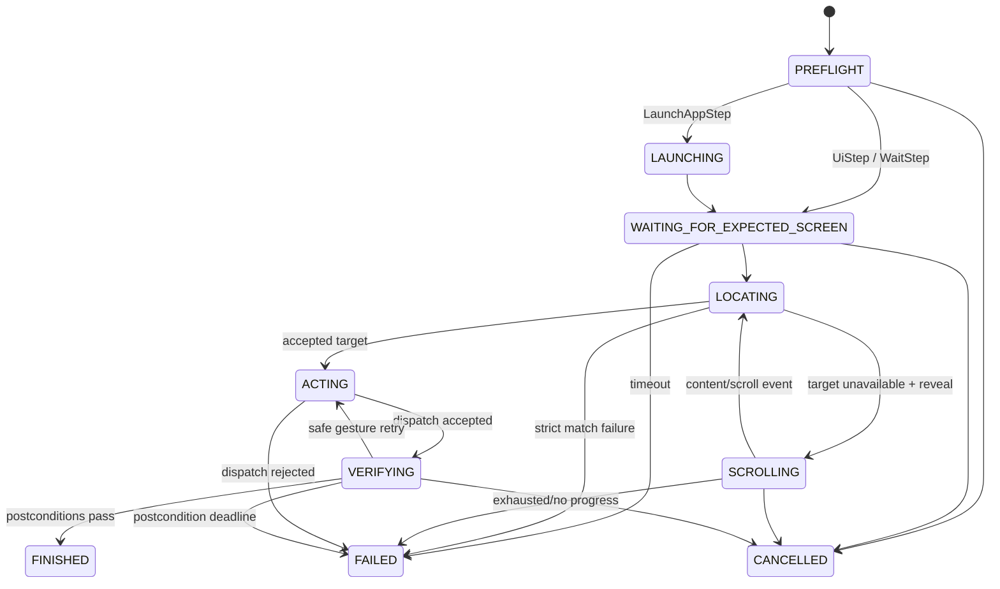

# Engine v2 replay state machine

Work Package 4 is the pure-Kotlin replay coordinator. It works solely with immutable window
snapshots and the `UiEnvironment` adapter boundary; it has no `android.*` dependency and never
retains platform accessibility nodes across a wait.

The expected-screen, locating, and verification loops snapshot immediately, then wait for an
environment event, cancellation event, or safety poll. A screen is stable after matching fingerprints
in two snapshots at least 100 ms apart, or after 300 ms with no relevant event. Recorded human delays
are diagnostic only; the only explicit time delay is `WaitStep`.

### Expected-screen phase
1. **Hard expected window**: The expected window (package name, window type, activity when observable) is a hard requirement. If the window does not appear before the step deadline, replay fails with `WINDOW_NOT_FOUND` or `WINDOW_AMBIGUOUS`.
2. **Soft fingerprint hint**: `expectedBefore` screen fingerprint similarity is a soft hint. The engine waits up to 1.5 s (event-driven) for fingerprint similarity $\ge 0.80$. If satisfied, it proceeds with `fingerprintSatisfied = true`. If the 1.5 s window elapses without reaching 0.80 similarity, it records `ExpectedScreenRecorded(fingerprintSatisfied = false)` in trace diagnostics and proceeds to locating anyway.
3. **Reveal steps skip fingerprint wait**: Steps defining a reveal policy (or scroll container) skip the fingerprint wait entirely because scrolling dynamically changes screen layout and content.

### Locating phase
Target element locating is non-terminal during the step timeout (default 7 s):
- If the target is initially missing, low confidence ($< 75$), or ambiguous, the engine does not fail immediately.
- It re-snapshots on every `UiEnvironmentEvent` (content changed, windows changed, focus changed) or the 250 ms safety poll and re-evaluates candidate matching.
- Replay only fails with the last decision's failure code (`TARGET_LOW_CONFIDENCE` or `TARGET_AMBIGUOUS`) if the step deadline expires.
- When a reveal policy or scroll container is present, `scrollToFind` runs first to uncover off-screen elements.

### Scroll-to-find & Reveal semantics
1. **Container fallback order**:
   - Selector-matched container (`isScrollContainer = true`).
   - Nearest scrollable ancestor of the leaf node hit-tested at the step's recorded point (`pointInWindow`).
   - Largest visible scrollable container in the current window that contains the hit point.
   - If no scrollable container is identified, fails with `SCROLL_CONTAINER_NOT_FOUND`.
2. **Content signature progress detection**:
   - Scroll progress is measured by the container's content signature—a hash over the container and its visible descendants (normalized text, content description, resource ID, bounds, collection row/col).
   - Two consecutive unchanged signatures result in `SCROLL_NO_PROGRESS`.
3. **Swipe direction semantics**:
   - `FORWARD` / `DOWN`: Reveals later content (finger moves up). Prefers `SCROLL_FORWARD` or `SCROLL_DOWN` semantic action; falls back to a gesture swipe from 75% to 25% of container height (300 ms) inside container visible bounds.
   - `BACKWARD` / `UP`: Reveals earlier content (finger moves down). Prefers `SCROLL_BACKWARD` or `SCROLL_UP` semantic action; falls back to a gesture swipe from 25% to 75% of container height (300 ms).
   - `LEFT` / `RIGHT`: Horizontal reveal gestures within container visible bounds.

## Default timeouts

| Concern | Default |
|---|---:|
| App launch | 12 s |
| Pre-step expected screen | 7 s |
| Expected screen fingerprint hint | 1.5 s |
| Post-action verification | 5 s |
| Text/focus verification | 2 s |
| Scroll-to-find | 10 s / 12 attempts |
| Stable quiet window | 300 ms |
| Safety poll | 250 ms |

## Failure codes

| Code | Meaning |
|---|---|
| `WINDOW_NOT_FOUND`, `WINDOW_AMBIGUOUS` | Strict window selection could not choose a target. |
| `EXPECTED_SCREEN_TIMEOUT` | Launch did not satisfy its fingerprint/activity contract before deadline. |
| `TARGET_LOW_CONFIDENCE`, `TARGET_AMBIGUOUS` | The shared strict selector matcher rejected the element after step timeout. |
| `SCROLL_CONTAINER_NOT_FOUND`, `SCROLL_NO_PROGRESS`, `TARGET_NOT_FOUND_AFTER_SCROLL` | Reveal could not safely reach the target. |
| `DISPATCH_REJECTED` | The adapter rejected dispatch, focus did not establish, or a gesture point failed current hit-testing. |
| `VERIFICATION_FAILED` | A concrete postcondition did not become true before its deadline. |
| `UNVERIFIABLE_STEP`, `DECODE_FAILED` | Static preflight rejects the workflow before touching the screen. |
| `CANCELLED`, `ACCESSIBILITY_UNAVAILABLE` | Caller cancellation or adapter disconnect interrupted replay. |

## Android adapter contract (WP5)

WP5 implements `UiEnvironment` and translates each `UiActionRequest` from current immutable
snapshots. It must emit `WindowsChanged`, `ContentChanged`, `FocusChanged`, and
`AccessibilityDisconnected` promptly; cancellation must use `ReplayCancellationSignal.events()`
so a wait interrupts without waiting for the safety poll.

| Request form | Adapter obligation |
|---|---|
| `dispatchMethod = SEMANTIC_ACTION`, `semanticAction` | Invoke exactly that accessibility action on `windowId`/`nodeId`; do not climb arbitrary parents. |
| `dispatchMethod = GESTURE`, `gesturePoints` | Dispatch the supplied current-screen points and duration/path. The points are already remapped to current bounds. |
| `text` + `semanticAction = SET_TEXT` | Set the supplied text on the exact focused editable node. Never put text in diagnostics. |
| `imeAction` + `semanticAction = IME_ENTER` | Perform the recorded IME action only for the exact focused field; provide the platform-specific action-button path on pre-API-30 devices. |
| `globalAction` + `GLOBAL_ACTION` | Invoke only the requested system/global action. |
| `currentActivityClass(windowId)` | Return the observed activity when accessibility provides it; return `null` rather than guessing. |

`Accepted` means the request was delivered, not that the workflow step succeeded. The engine always
re-snapshots and evaluates postconditions. Trace events deliberately carry IDs, score summaries,
and action outcomes only—never node text, content descriptions, titles, or entered text.
