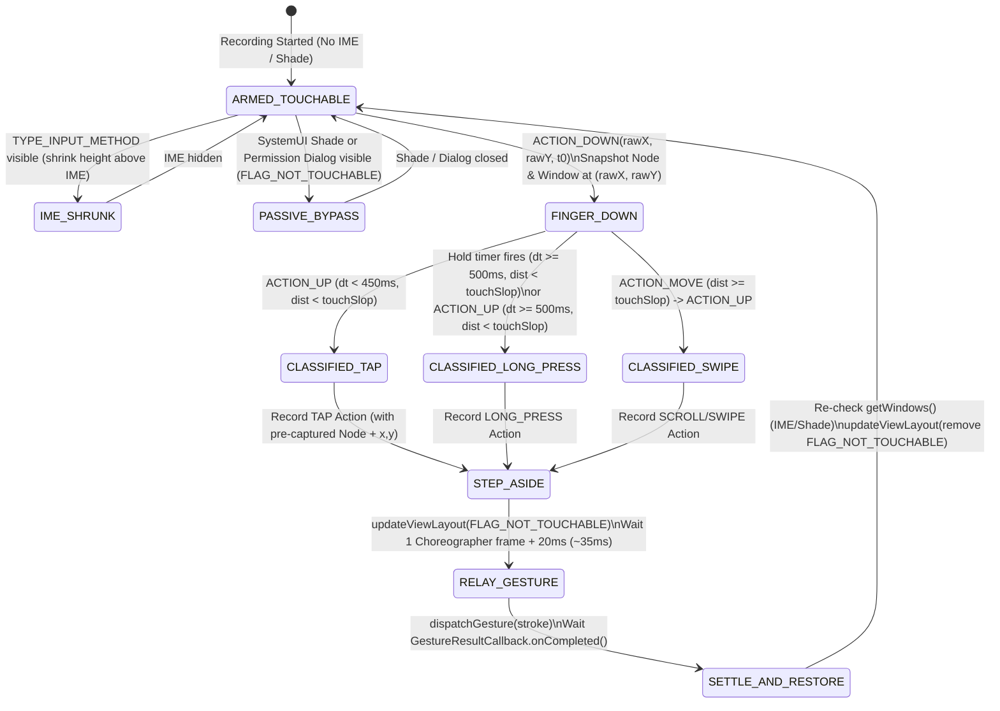

> Research brief output (2026-10-17). Recommendation adopted by the owner: the capture-and-relay overlay is the default recorder; Shizuku is a later optional power mode. Claims marked as inference must be confirmed by the on-device experiments at the end before the design is locked. Note: the owner's Pixel 6a uses 3-button navigation, not gesture navigation.

# Android Touch & UI Recording Architecture Research (SDK 26–36, No Root)

## Executive Recommendation

RepeatKit should adopt a **Hybrid Active Capture-and-Relay Overlay (`TYPE_ACCESSIBILITY_OVERLAY`) + Passive Semantic/IME Listener** as its **PRIMARY** recording architecture, keep **Passive Accessibility Event Capture (`TYPE_VIEW_TEXT_CHANGED` + focused-node polling + `TYPE_VIEW_SCROLLED`)** for text entry and post-relay scroll verification, retain **Shizuku (`getevent` + `input`/binder injection)** as an **OPTIONAL POWER-USER** zero-latency mode, and **REJECT `TouchInteractionController` (`FLAG_REQUEST_TOUCH_EXPLORATION_MODE`)** and **pure passive `TYPE_VIEW_CLICKED` capture**. Specifically, the previous agent's blanket claim that a capture-and-relay overlay "cannot work and breaks scrolling and the keyboard" is **only true if you try to relay strokes in real time while the finger is down** (because `AccessibilityService.dispatchGesture()` cancels active physical touches and hits the overlay itself if it remains touchable) **or if the overlay covers the soft keyboard (`TYPE_INPUT_METHOD`)**. When the overlay instead: (1) classifies gestures on the overlay up to release (or long-press threshold), (2) snapshots the underlying accessibility node tree across `getWindows()` **before** relaying, (3) steps aside via `FLAG_NOT_TOUCHABLE` and waits for `SurfaceFlinger`’s input-window transaction commit (~1–2 vsync frames, 16–33 ms on Pixel 6a), (4) replays the tap/long-press/swipe via `dispatchGesture` (or `ACTION_CLICK` when a high-confidence semantic node is found), and (5) dynamically shrinks its height or switches to `FLAG_NOT_TOUCHABLE` whenever a `TYPE_INPUT_METHOD` window is visible so keyboard typing remains 100% native and captured passively via `TYPE_VIEW_TEXT_CHANGED`, it captures **100% of taps across Jetpack Compose, Flutter, React Native, WebView, and custom Canvas views** without enabling system-wide TalkBack/Explore-by-Touch side effects.

---

## 1. Capture-and-Relay Overlay (`TYPE_ACCESSIBILITY_OVERLAY`)

**Confidence Level:** High (Verified against AOSP `InputDispatcher.cpp`, `InputWindow.cpp`, `AccessibilityInputFilter.java`, `MotionEventInjector.java`, and `PhoneWindowManager.java`).

### 1.1 Do `dispatchGesture`-injected events hit-test against our own touchable accessibility overlay?
* **Finding (Documented AOSP behavior):** **Yes — the overlay MUST be made `FLAG_NOT_TOUCHABLE` (or removed/shrunk) before calling `dispatchGesture()`.**
* **AOSP Mechanism:**
  * `AccessibilityService.dispatchGesture()` crosses Binder via `IAccessibilityServiceConnection.sendGesture()` into `system_server`, where [`MotionEventInjector`](https://cs.android.com/android/platform/superproject/main/+/main:frameworks/base/services/accessibility/java/com/android/server/accessibility/MotionEventInjector.java) (a stage inside [`AccessibilityInputFilter`](https://cs.android.com/android/platform/superproject/main/+/main:frameworks/base/services/accessibility/java/com/android/server/accessibility/AccessibilityInputFilter.java)) synthesizes `MotionEvent` sequences with `POLICY_FLAG_INJECTED_FROM_ACCESSIBILITY | POLICY_FLAG_PASS_TO_USER`.
  * `InputFilter.sendInputEvent()` feeds those synthesized events back into `InputDispatcher` (`frameworks/native/services/inputflinger/dispatcher/InputDispatcher.cpp`).
  * `InputDispatcher::findTouchedWindowTargetsLocked()` performs normal top-down Z-order hit-testing against the current `InputWindowHandle` list received from `SurfaceFlinger`. Because our `TYPE_ACCESSIBILITY_OVERLAY` sits above `TYPE_APPLICATION` and does not distinguish synthetic accessibility touches from hardware touches, a touchable overlay will intercept its own `dispatchGesture()` stroke, causing a self-hit loop and starving the underlying app.

### 1.2 How long does `updateViewLayout(FLAG_NOT_TOUCHABLE)` take to reach `InputDispatcher`?
* **Finding (Documented AOSP behavior + timing inference):**
  * Calling `WindowManager.updateViewLayout(overlayView, paramsWithNotTouchable)` updates `WindowState` in `WindowManagerService` (`InputMonitor.updateInputWindowsLw()`), which stages an `InputWindowInfo` update inside a `SurfaceControl.Transaction`.
  * In Android 12+ (API 31–36), `InputDispatcher` only learns about updated window flags after `SurfaceFlinger` commits the transaction on the next VSync and invokes `InputDispatcher::setInputWindows()`.
  * **Reliable Signal (API 31+ / Android 12+, which covers Pixel 6a on Android 16):** Attach a `SurfaceControl.TransactionCommittedListener` via `overlayView.rootSurfaceControl?.applyTransactionOnDraw(transaction)` or register a `Choreographer.getInstance().postFrameCallback` after `updateViewLayout()` + `overlayView.invalidate()`. When the **next** frame's draw transaction commits (or after **2 `Choreographer` vsync callbacks**), `SurfaceFlinger` has latched the new `InputWindowInfo` (`FLAG_NOT_TOUCHABLE`) and pushed it to `InputDispatcher`.
  * **Safe Delay Constant:** On a 60 Hz display (Pixel 6a), 1 VSync is `16.67 ms`. Waiting for **1 `Choreographer` frame callback + `20 ms`** (or a flat **`35 ms`** fallback if no frame callback fires because the view is transparent/clean) reliably avoids self-interception.
  * **Optimization (Zero-Wait Alternative for Semantic Nodes):** If hit-testing at `(rawX, rawY)` on `ACTION_UP` resolves a node with `isClickable == true` (including Compose/Flutter/WebView virtual nodes!), you can invoke `node.performAction(AccessibilityNodeInfo.ACTION_CLICK)` **immediately (0 ms delay)** without even toggling `FLAG_NOT_TOUCHABLE` or calling `dispatchGesture()`, because `ACTION_CLICK` travels over Binder directly to `ViewRootImpl` / `AccessibilityNodeProvider`, bypassing `InputDispatcher` completely! Reserve the `FLAG_NOT_TOUCHABLE` → `dispatchGesture()` relay path for: (a) swipes/scrolls, (b) unlabelled/canvas coordinates where `ACTION_CLICK` returns `false` or no clickable node exists, or (c) when you want real pointer coordinate dispatch.

### 1.3 Does `dispatchGesture` cancel gestures in progress? Can a drag be relayed in real time?
* **Finding (Documented AOSP behavior):** **Real-time relay while the user's finger is still on the screen is impossible with `dispatchGesture()`.**
* **AOSP Mechanism:**
  * Official SDK Javadoc for `AccessibilityService.dispatchGesture()` and AOSP `MotionEventInjector.onMotionEvent()` state that:
    1. When `MotionEventInjector` is injecting a gesture and **any physical `MotionEvent`** arrives from hardware input devices, `MotionEventInjector` immediately sends `ACTION_CANCEL` to the injected gesture and invokes `GestureResultCallback.onCancelled()`.
    2. Conversely, when a new gesture is dispatched, active touch streams are cancelled.
  * Therefore, `StrokeDescription(..., willContinue = true)` / `continueStroke()` **cannot** be used to shadow a user's live finger on the same display, because the user's ongoing physical `ACTION_MOVE` events on the screen collide with `MotionEventInjector` inside `AccessibilityInputFilter`.
  * All gesture relay via `dispatchGesture()` **must** happen **after `ACTION_UP`** (post-release buffered relay).

### 1.4 Can a swipe/fling be relayed after release with velocity preserved? What is the UX?
* **Finding (Documented AOSP behavior + UX inference):**
  * **Velocity preservation:** Yes. `RecyclerView`, `NestedScrollView`, and Compose `LazyColumn` compute fling velocity using `VelocityTracker` over the `MotionEvent` timestamps and coordinates delivered by `InputDispatcher`.
  * When you record the user's `(x_i, y_i, t_i)` samples between `ACTION_DOWN` and `ACTION_UP` (or fit a multi-point `Path` from `(startX, startY)` through intermediate points to `(endX, endY)`) and pass `duration = (upTime - downTime).coerceIn(50L, 800L)` to `GestureDescription.StrokeDescription(path, 0L, duration)`, `MotionEventInjector` interpolates `ACTION_MOVE` events at `16 ms` intervals along `Path` over `duration`. The terminal velocity seen by the target app's `VelocityTracker` matches `distance / duration`, so `RecyclerView` and `LazyColumn` fling the expected distance.
  * **Expected UX ("list jumps after you lift your finger"):** While the user drags their finger across the transparent overlay, the underlying list remains stationary; as soon as the finger lifts (`ACTION_UP`), the list scrolls/flings smoothly along the swipe trajectory.
  * **Visual Mitigation:** Drawing a lightweight, translucent gesture trail (a fading stroke line or ripple on the overlay canvas during `ACTION_MOVE`) transforms the UX from "the screen feels frozen until I lift my finger" into "I am drawing a gesture for RepeatKit, which immediately executes when I release."

### 1.5 Z-Order vs. IME, Notification Shade, Gesture Navigation, Status Bar, Permission Dialogs, and SystemUI
* **Finding (Documented AOSP behavior in `PhoneWindowManager.getWindowLayerFromTypeLw` & `InputDispatcher`):**
  In AOSP (`frameworks/base/services/core/java/com/android/server/wm/WindowManagerPolicy.java`), window types map to Z-order layers (1–36):
  * `TYPE_APPLICATION`: Layer **2**
  * `TYPE_INPUT_METHOD` (IME / Gboard): Layer **15**
  * `TYPE_STATUS_BAR`: Layer **17 / 18**
  * `TYPE_NOTIFICATION_SHADE`: Layer **21 / 22**
  * `TYPE_NAVIGATION_BAR`: Layer **24**
  * `TYPE_VOLUME_OVERLAY`: Layer **25**
  * `TYPE_ACCESSIBILITY_OVERLAY`: Layer **31** (almost the very top of the Z-order stack, below only `TYPE_MAGNIFICATION_OVERLAY` [32] and `TYPE_SECURE_SYSTEM_OVERLAY` [35]).

  | Surface / Interaction | Z-Order vs `TYPE_ACCESSIBILITY_OVERLAY` (Layer 31) | Reachable while full-screen overlay is touchable? | Required Handling |
  | :--- | :--- | :--- | :--- |
  | **Normal App Windows & App Dialogs** (`TYPE_APPLICATION`) | Below (Layer 2) | Intercepted by overlay | Normal capture-and-relay target. |
  | **Permission Controller / Package Installer** (`com.google.android.permissioncontroller`) | Below (Layer 2, standard Activity) | Intercepted by overlay | Detect package in [`RecorderSession.KNOWN_TRANSIENT_PACKAGES`](../../app/src/main/java/com/shortcuts/app/service/RecorderSession.kt#L575-L584) via `getWindows()` and set overlay `FLAG_NOT_TOUCHABLE` while a transient security/permission dialog is active (Android also blocks `dispatchGesture` or `ACTION_CLICK` on permission dialogs unless exempted). |
  | **Soft Keyboard / IME** (`TYPE_INPUT_METHOD`, e.g., Gboard) | **Below** (Layer 15 < Layer 31) | **NO — blocked by full-screen overlay!** | **CRITICAL:** A full-screen touchable `TYPE_ACCESSIBILITY_OVERLAY` covers the IME and eats keyboard taps! The overlay **must** monitor `getWindows()` for `AccessibilityWindowInfo.TYPE_INPUT_METHOD` and resize its height/bounds to stay strictly **above** `imeWindow.getBoundsInScreen().top` (or become `FLAG_NOT_TOUCHABLE` inside the IME rect). |
  | **System Gesture Navigation (Back edge swipe, Home pill swipe-up)** | Handled by System `InputConsumer` / `SystemGesturesPointerEventListener` | **YES (Mostly reachable)** | In AOSP `InputDispatcher`, system edge gestures are claimed via `InputMonitor` / `InputConsumer` (`recents_animation_input_consumer`, `WallpaperInputConsumer`) and `DisplayPolicy` system gesture exclusion rects. However, to guarantee zero interference with Android 16 edge-back and bottom home-bar swipes, inset the overlay window by the system gesture insets (`WindowInsets.Type.systemGestures()` / `navigationBars()` / `statusBars()`, ~24–32 dp on left/right edges, ~48 dp at top/bottom). |
  | **Status Bar Pull-Down / Notification Shade** (`TYPE_NOTIFICATION_SHADE`) | **Below** (Layer 22 < Layer 31) | **Blocked** if overlay covers top status bar, **AND covers the open shade!** | Inset the overlay below `WindowInsets.Type.statusBars()`, AND when `getWindows()` reports a window from `com.android.systemui` (notification shade / quick settings open), switch the overlay to `FLAG_NOT_TOUCHABLE` so the user can tap **Stop** on RepeatKit's recording notification! |

### 1.6 Typing: Is Passive Capture of Text Reliable Across View `EditText` and Compose `TextField`?
* **Finding (Documented behavior in Android View & Compose UI 1.7–1.9):** **Yes, highly reliable — provided the overlay does not cover the IME.**
* **Why:**
  * Both classic `EditText` (`TextView.sendAccessibilityEventUnchecked`) and Jetpack Compose `TextField` / `BasicTextField` (both `TextFieldValue` and `TextFieldState` / `BasicTextField2` in Compose 1.7–1.9 via `AndroidComposeViewAccessibilityDelegateCompat`) reliably emit `TYPE_VIEW_TEXT_CHANGED` and `TYPE_VIEW_TEXT_SELECTION_CHANGED` on every character edit, and update their virtual node's `text` property and `FOCUS_INPUT` state.
  * RepeatKit's existing [`AutomationRecorder.refreshTrackedFocusedText`](../../app/src/main/java/com/shortcuts/app/service/AutomationRecorder.kt#L637-L667) + `TYPE_VIEW_TEXT_CHANGED` pipeline in [`RecorderSession.processTextChangeLocked`](../../app/src/main/java/com/shortcuts/app/service/RecorderSession.kt#L422-L437) already handles debounced full-text capture and Chrome omnibox live-node fallback cleanly.
  * Furthermore, because our overlay intercepts the initial tap that focuses the `TextField`, we know the exact `(x, y)` and resolved editable node *even in Compose apps where tapping the `TextField` did not emit `TYPE_VIEW_CLICKED`*, so we can set `focusedField` reliably every time!

### 1.7 Latency & Android 14/15/16 Untrusted Touch / `FLAG_WINDOW_IS_OBSCURED` Restrictions
* **Expected Per-Tap Latency:**
  * Finger tap duration (`ACTION_DOWN` to `ACTION_UP`): ~50–90 ms (natural human tap).
  * Tree hit-test (`getWindows()` + `findNodeAtPoint`): **3–12 ms**.
  * Step-aside (`updateViewLayout(FLAG_NOT_TOUCHABLE)` + 1–2 VSyncs): **20–35 ms**.
  * `dispatchGesture()` stroke duration: **40–60 ms** (currently `TAP_DURATION_MS = 60L` in [`AutomationAccessibilityService.kt`](../../app/src/main/java/com/shortcuts/app/service/AutomationAccessibilityService.kt)).
  * **Total post-lift visual response latency:** **~65–105 ms** after finger-up (or **~10–15 ms** if fast-pathed via `node.performAction(ACTION_CLICK)`). A <100 ms post-release delay is well within normal human UI perception.
* **Android 12–16 Untrusted Touch Blocking & `FLAG_WINDOW_IS_OBSCURED` (Documented AOSP behavior):**
  * In AOSP `frameworks/native/libs/input/InputWindow.cpp`:
    ```cpp
    bool InputWindowInfo::isTrustedOverlay() const {
        return layoutParamsType == Type::INPUT_METHOD ||
               layoutParamsType == Type::INPUT_METHOD_DIALOG ||
               layoutParamsType == Type::MAGNIFICATION_OVERLAY ||
               layoutParamsType == Type::STATUS_BAR ||
               layoutParamsType == Type::NOTIFICATION_SHADE ||
               layoutParamsType == Type::NAVIGATION_BAR ||
               layoutParamsType == Type::ACCESSIBILITY_OVERLAY || ...;
    }
    ```
  * Because `TYPE_ACCESSIBILITY_OVERLAY` returns `true` for `isTrustedOverlay()` (and `WindowManagerService` sets `InputApplicationHandle` trusted flags for bound `AccessibilityService` windows):
    1. **Android 12–16 Untrusted Touch Blocking (`BlockUntrustedTouchesMode`):** **Exempt.** `InputDispatcher::shouldDropInput()` never drops touches passing through a `TYPE_ACCESSIBILITY_OVERLAY` with `FLAG_NOT_TOUCHABLE` or `FLAG_WATCH_OUTSIDE_TOUCH`.
    2. **`FLAG_WINDOW_IS_OBSCURED` / `FLAG_WINDOW_IS_PARTIALLY_OBSCURED` / `View.filterTouchesWhenObscured`:** **Exempt.** In `InputDispatcher::addWindowTargetLocked()` (`canBeObscuredBy()`), windows where `isTrustedOverlay() == true` are **ignored** when computing occlusion! Furthermore, touches injected via `dispatchGesture()` carry `POLICY_FLAG_INJECTED_FROM_ACCESSIBILITY` while our overlay is `FLAG_NOT_TOUCHABLE`, so even banking/security apps with `android:filterTouchesWhenObscured="true"` **do not** see `FLAG_WINDOW_IS_OBSCURED` and **do not** reject relayed taps.

---

## 2. `TouchInteractionController` (API 33+)

**Confidence Level:** High (Verified against AOSP `TouchInteractionController.java`, `TouchExplorer.java`, and `AccessibilityUserState.java`).

### 2.1 Can it pass normal single taps and scrolls straight through via `requestDelegating()` / `performClick()`?
* **Finding (Documented AOSP behavior):**
  * In API 33+, if an `AccessibilityService` sets `AccessibilityServiceInfo.FLAG_REQUEST_TOUCH_EXPLORATION_MODE`, the framework inserts [`TouchExplorer`](https://cs.android.com/android/platform/superproject/main/+/main:frameworks/base/services/accessibility/java/com/android/server/accessibility/gestures/TouchExplorer.java) into `AccessibilityInputFilter` and exposes `AccessibilityService.getTouchInteractionController(Display.DEFAULT_DISPLAY)`.
  * When the user touches the screen, `TouchInteractionController.Callback.onMotionEvent(MotionEvent)` receives the raw `ACTION_DOWN` and `ACTION_MOVE` stream *before* the app sees it.
  * If the service immediately calls `controller.requestDelegating()` on `ACTION_DOWN` (or once movement exceeds touch slop), `TouchExplorer` transitions to `STATE_DELEGATING` and forwards the motion stream downstream to `InputDispatcher` (allowing normal scrolling/dragging). Or on a quick tap, calling `controller.performClick()` clicks the accessibility-focused point.

### 2.2 What are the side effects? Why is it NOT viable as RepeatKit's recording mode?
Despite `requestDelegating()` existing in API 33+, enabling `FLAG_REQUEST_TOUCH_EXPLORATION_MODE` has **severe, unavoidable system-wide side effects** documented in AOSP:
1. **`AccessibilityManager.isTouchExplorationEnabled()` becomes `true` system-wide:**
   * In `AccessibilityManagerService` / `AccessibilityUserState`, enabling `FLAG_REQUEST_TOUCH_EXPLORATION_MODE` sets `mIsTouchExplorationEnabled = true` and broadcasts `TouchExplorationStateChangeListener` to **every running app** on the phone.
   * **Apps radically mutate their UI and behavior when `isTouchExplorationEnabled == true`:**
     * **Gboard / Soft Keyboards:** Switch from normal tap-to-type into **lift-to-type / explore-by-touch mode** unless special flags are negotiated, or change key repeat/long-press behavior.
     * **Chrome / WebView:** Instantiates the heavy full DOM accessibility tree and changes scroll containers, carousel auto-advance, and popup dismissal behavior.
     * **Video Players (YouTube, Netflix) & Maps:** Keep player overlay controls permanently pinned on screen instead of auto-hiding, or expose screen-reader-only buttons that **will not exist during replay** when `FLAG_REQUEST_TOUCH_EXPLORATION_MODE` is turned back off!
     * **Jetpack Compose & Flutter:** Alter semantics merging, traversal order, and hover handling (`TYPE_VIEW_HOVER_ENTER`/`EXIT`).
2. **Every touch pays a round-trip Binder + classification delay:**
   * Even if you call `requestDelegating()` inside `onMotionEvent(ACTION_DOWN)`, `TouchExplorer` holds the `ACTION_DOWN` in `system_server`, sends it over Binder to `AutomationAccessibilityService`, waits for `requestDelegating()` Binder IPC back to `system_server`, and only then replays the delayed `ACTION_DOWN` into `InputDispatcher`. Fast taps (<40 ms) can finish (`ACTION_UP`) before `requestDelegating()` arrives in `system_server`, causing `TouchExplorer` to swallow the tap or throw `IllegalStateException` (because the touch interaction already ended).
3. **Conflict with TalkBack / System Gestures:**
   * Enabling `FLAG_REQUEST_TOUCH_EXPLORATION_MODE` changes 1-finger system edge gestures (Back/Home require 2 fingers unless `SERVICE_FLAG_REQUEST_2_FINGER_PASSTHROUGH` is also active and supported).
* **Verdict:** **Reject `TouchInteractionController`.** The UI mutation problem alone (recording against an Explore-by-Touch UI tree and replaying against a non-Explore-by-Touch UI tree) is fatal for an automation recorder.

---

## 3. Passive Capture Across UI Frameworks

**Confidence Level:** High (Verified against AOSP `View.java`, Jetpack Compose `AndroidComposeViewAccessibilityDelegateCompat.android.kt`, Flutter `AccessibilityBridge.java`, React Native `ReactAccessibilityDelegate.java`, and Chromium `BrowserAccessibilityManager.java`).

### 3.1 What accessibility events do modern frameworks emit for an ordinary finger tap and text input?

| UI Framework | Ordinary Finger Tap (`isTouchExplorationEnabled == false`) | Text Input (`EditText` / Input Field) | Scroll / Fling |
| :--- | :--- | :--- | :--- |
| **Android `View` (`Button`, `View.OnClickListener`)** | Emits **`TYPE_VIEW_CLICKED`** from `View.performClick()` (unless a custom `OnTouchListener` consumes `ACTION_UP` and returns `true` without calling `performClick()`). | Emits **`TYPE_VIEW_TEXT_CHANGED`** + `TYPE_VIEW_TEXT_SELECTION_CHANGED` + `TYPE_VIEW_FOCUSED`. | Emits `TYPE_VIEW_SCROLLED` (`RecyclerView`, `ScrollView`). |
| **Jetpack Compose (1.7–1.9)** | **Emits NO `TYPE_VIEW_CLICKED`.** `Modifier.clickable` handles pointer input in Kotlin (`detectTapAndPress`) and invokes `onClick()` directly. `AndroidComposeViewAccessibilityDelegateCompat` only calls `sendEventForVirtualView(id, TYPE_VIEW_CLICKED)` inside `performActionHelper` when `ACTION_CLICK` is invoked via Accessibility! May emit `TYPE_WINDOW_CONTENT_CHANGED` if the tap mutates state. | **Emits `TYPE_VIEW_TEXT_CHANGED`** and `TYPE_VIEW_TEXT_SELECTION_CHANGED` (via `TextField` semantics change observer in `AndroidComposeViewAccessibilityDelegateCompat`). | Emits **`TYPE_VIEW_SCROLLED`** (via `ScrollAxisRange` semantics observer in Compose delegate). |
| **Flutter (3.x)** | **Emits NO `TYPE_VIEW_CLICKED`.** Pointer events go to `AndroidTouchProcessor` → Dart `GestureBinding`. Furthermore, Flutter's `AccessibilityBridge` only sends `TYPE_VIEW_CLICKED` when `performAction(ACTION_CLICK)` is called or when a semantics flag explicitly changes. | Often uses a platform `InputConnection` on `FlutterView`; emits `TYPE_VIEW_TEXT_CHANGED` on the host `FlutterView`, or updates the virtual semantics node with `SCOPES_ROUTE` / `IS_TEXT_FIELD`. | Emits `TYPE_VIEW_SCROLLED` only if the semantics tree is active and `SCROLL_EXTENT` updates. |
| **React Native (Paper & Fabric / New Arch)** | **Inconsistent.** `Pressable` / `TouchableOpacity` handles touches in JS/C++ `EventEmitter` (`onTouchEnd`) without calling `View.performClick()`. Unless the developer explicitly triggers native click or accessibility action, **`TYPE_VIEW_CLICKED` is NOT emitted** for ordinary finger taps. | Backed by native `ReactEditText` (subclass of `AppCompatEditText`), so **`TYPE_VIEW_TEXT_CHANGED` IS reliably emitted**. | Backed by native `ReactScrollView` / `ReactHorizontalScrollView`, so **`TYPE_VIEW_SCROLLED` IS reliably emitted**. |
| **Chromium WebView** | **Usually NO `TYPE_VIEW_CLICKED` on finger tap.** Touch events go straight to Blink compositor/main thread. `BrowserAccessibilityManager` primarily emits `TYPE_VIEW_CLICKED` when triggered via `AccessibilityNodeProvider.performAction(ACTION_CLICK)`. | Emits `TYPE_VIEW_TEXT_CHANGED` / `TYPE_VIEW_TEXT_SELECTION_CHANGED` via `ImeAdapterImpl`. | Emits `TYPE_VIEW_SCROLLED` / `TYPE_WINDOW_CONTENT_CHANGED`. |

### 3.2 Can any combination of passive events reveal tap locations without Touch Exploration?
* **Finding (Documented AOSP behavior):** **No.**
  * `TYPE_TOUCH_INTERACTION_START`, `TYPE_TOUCH_INTERACTION_END`, `TYPE_TOUCH_EXPLORATION_GESTURE_START/END`, and `TYPE_VIEW_HOVER_ENTER/EXIT` are **only** emitted by `TouchExplorer` when `FLAG_REQUEST_TOUCH_EXPLORATION_MODE` is active (`AccessibilityInputFilter.java`). Without touch exploration, those events are never generated.
  * `TYPE_VIEW_ACCESSIBILITY_FOCUSED` is only emitted when an accessibility service moves `ACTION_ACCESSIBILITY_FOCUS` (e.g., TalkBack).
  * `WindowManager.LayoutParams.FLAG_WATCH_OUTSIDE_TOUCH` on a `0x0` window only delivers `MotionEvent.ACTION_OUTSIDE`, and since **Android 4.2 (API 17)** (and tightened further in Android 8.0+), `InputDispatcher` zeroes out (`0, 0`) or obscures the coordinates of `ACTION_OUTSIDE` for cross-UID windows to prevent tap-coordinate snooping (`AMOTION_EVENT_FLAG_WINDOW_IS_OBSCURED`).
  * Therefore, **an active touchable `TYPE_ACCESSIBILITY_OVERLAY` is the only non-root, non-Explore-by-Touch mechanism on Android that receives exact `(rawX, rawY)` coordinates for every finger touch.**

---

## 4. Hit-Testing (`getWindows()` + Node Tree Resolution)

**Confidence Level:** High (Verified against AOSP `AccessibilityWindowInfo`, `AccessibilityNodeInfo`, and RepeatKit's [`TapMarkOverlay.kt`](../../app/src/main/java/com/shortcuts/app/service/TapMarkOverlay.kt#L313-L374)).

### 4.1 Why RepeatKit's current `TapMarkOverlay.findNodeAtPoint` misses dialogs, bottom sheets, and split windows
In [`TapMarkOverlay.kt:313-321`](../../app/src/main/java/com/shortcuts/app/service/TapMarkOverlay.kt#L313-L321), `findNodeAtPoint` only checks `service.getRootNode()` (`rootInActiveWindow`) and returns the first child loop match. This has four major flaws:
1. **`rootInActiveWindow` can be wrong or null:** When a non-focused popup window, floating toolbar, or secondary window is tapped, `rootInActiveWindow` may point to the main activity behind the popup (or briefly be null).
2. **Sibling overlap bug (`TapMarkOverlay.kt:350-367`):** `findDeepestNodeContaining` loops `for (i in 0 until node.childCount)` in **ascending** order (`0 .. childCount - 1`) and returns on the **first** child whose bounds contain `(x, y)`! In Android `ViewGroup` and Jetpack Compose, children later in the list (`childCount - 1` down to `0`) are drawn **on top of** earlier siblings (unless custom Z/elevation is set, which Android's `AccessibilityNodeInfo` order reflects when `getChild()` is populated in drawing order). Ascending iteration hits background containers/scrims instead of the top sibling!
3. **Does not check `node.isVisibleToUser`:** Off-screen or `alpha = 0` or hidden view pager pages can still have screen bounds overlapping `(x, y)` and get matched ahead of visible nodes.
4. **Does not distinguish clickable semantic targets from decorative leaf nodes:** In Android Views (and unmerged Compose nodes), the deepest leaf at `(x, y)` is often an unlabelled `ImageView` or decorative `View` inside a clickable `LinearLayout`/`CardView` whose sibling `TextView` holds the label.

### 4.2 The Robust Multi-Window Hit-Testing Algorithm
Given screen point `(x, y)` captured on `ACTION_DOWN` (or `ACTION_UP` before relay):

1. **Iterate `service.windows` in top-down Z-order:**
   * `AccessibilityService.getWindows()` (enabled because `flagRetrieveInteractiveWindows` is already set in [`accessibility_service_config.xml`](../../app/src/main/res/xml/accessibility_service_config.xml)) returns windows sorted in **descending layer order (highest Z-order first)**.
   * **Filter out our own overlay windows:** Skip any `AccessibilityWindowInfo` where `window.type == AccessibilityWindowInfo.TYPE_ACCESSIBILITY_OVERLAY` or `window.root?.packageName == service.packageName`.
   * Pick the **first** remaining window whose `window.getBoundsInScreen(rect)` contains `(x, y)` and has a non-null `window.root`. (Fall back to `rootInActiveWindow` only if `windows` is empty).
2. **Collect ALL visible nodes containing `(x, y)` in reverse child order:**
   * Traverse the chosen window's root recursively:
     * Check `node.getBoundsInScreen(bounds)`. Note: In Compose/WebView, a parent layout node occasionally has `0x0` or smaller bounds than an overflowing child, so only prune a subtree if `!bounds.contains(x, y) && node.childCount == 0` (or check children if bounds are empty).
     * Require `node.isVisibleToUser`.
     * Iterate children in **reverse order** (`for (i in node.childCount - 1 downTo 0)`) so higher-Z siblings are visited first.
3. **Score and select the winning node + clickable ancestor:**
   * Among nodes containing `(x, y)`:
     * Find the deepest visible leaf node `leafNode`.
     * Walk up from `leafNode` to find the nearest ancestor (or `leafNode` itself) where `isClickable || isLongClickable || isEditable || isCheckable || actionList.contains(ACTION_CLICK)` — call this `interactiveNode`.
     * If `interactiveNode` exists and its bounds are reasonable (e.g., `< 80%` of screen area, so we don't accidentally pick a full-screen root modal scrim that has a click listener), choose `interactiveNode` as the primary target and run [`deriveNodeLabel`](../../app/src/main/java/com/shortcuts/app/service/AutomationRecorder.kt#L843-L908) on `interactiveNode` (falling back to `leafNode` if `interactiveNode` has more than one distinct labelled branch).
     * Rank by smallest bounding-box area (`bounds.width() * bounds.height()`) as tie-breaker so tight buttons always beat large parent rows.
4. **Framework-Specific Edge Cases:**
   * **Compose Merged Semantics:** Compose merges child `Text`/`Icon` semantics into a single `Modifier.clickable` virtual node automatically, so `interactiveNode` is usually also the leaf node and already carries the merged `text` / `contentDescription` (and `testTag` as `viewIdResourceName` if `testTagsAsResourceId = true`).
   * **WebView Virtual Nodes:** If a WebView hasn't hydrated its virtual accessibility tree yet, calling `window.root` when our `AccessibilityService` is bound with `canRetrieveWindowContent="true"` forces Chromium to populate `AccessibilityNodeProvider`.

---

## 5. Prior Art (How Existing Android Automation Apps Work Without Root)

**Confidence Level:** High (Verified against public documentation and APK behavior of MacroDroid, Tasker AutoInput, Automate, Macrorify, Auto Clicker, and Google Action Blocks / Voice Access).

| App / Tool | How Target Selection / Recording Works (No Root) | What They Chose & Documented Limitations |
| :--- | :--- | :--- |
| **MacroDroid** (*UI Interaction* action) | Uses an explicit **"Identify in App" helper mode**: user clicks "Identify in app" → navigates to target app → taps a floating notification/overlay button → MacroDroid freezes/captures the next single touch via a one-shot `TYPE_ACCESSIBILITY_OVERLAY` (identical to RepeatKit's `TapMarkOverlay`) or inspects `TYPE_VIEW_CLICKED`, resolves node text/ID/x,y, and adds ONE step. | Does **not** offer continuous multi-step flow recording with transparent touch relay. Documents that users must add steps one by one via the overlay picker when `TYPE_VIEW_CLICKED` is missing. |
| **Tasker AutoInput** (*Easy Setup* / *Actions v2*) | Uses a floating overlay bar ("Navigate to the app, then tap 'Add' on this overlay, then tap the element"). In "Add" mode, a full-screen touchable overlay catches the single tap `(x, y)`, walks `getWindows()` to list all nodes under `(x, y)`, and asks the user whether to match by Text, ID, or Point. | Does not continuously relay touches during setup; the user switches between "Navigate" (overlay non-touchable) and "Capture" (overlay touchable, eats the tap). |
| **Automate (LlamaLab)** (*Interact* / *Interact Touch* block) | Provides an **Inspector overlay** that draws bounding boxes of all `AccessibilityNodeInfo`s on screen so the user can tap a box to generate an XPath selector, plus a passive "Record interaction" mode that only listens to `TYPE_VIEW_CLICKED` / `TYPE_VIEW_SCROLLED`. | Explicitly documents that passive "Record interaction" misses custom/Compose views that don't emit accessibility events, directing users to the visual Inspector overlay instead. |
| **Macrorify** & **Auto Clicker (True Developers Studio)** | Focus on **coordinate/image macro recording**. In Record Mode, they put up a **full-screen transparent `TYPE_ACCESSIBILITY_OVERLAY`**, intercept every `ACTION_DOWN`..`ACTION_UP`, record the `(x, y)` / swipe path, toggle the overlay to **`FLAG_NOT_TOUCHABLE`**, call **`dispatchGesture()`** to relay the touch to the game/app underneath, and restore touchability in `GestureResultCallback.onCompleted()`. | **This proves the Capture-and-Relay Overlay pattern works in production at scale (10M+ installs).** Their documented limitation is what we noted in §1.3–1.5: swipes execute *after* finger release ("delayed drag"), and the user must toggle/pause the overlay if they need to type on the soft keyboard (unless IME bounds are excluded, which RepeatKit can automate!). |
| **Google Voice Access & Action Blocks** | Voice Access does not record user touches; it traverses `getWindows()` continuously, identifies clickable/scrollable nodes (plus visual OCR/icon detection ML models on screenshots), and overlays numbered badges (`1`, `2`, `3`) on a `FLAG_NOT_TOUCHABLE` `TYPE_ACCESSIBILITY_OVERLAY`, then executes `ACTION_CLICK` or `dispatchGesture()` at the node's center. | Confirms that `getWindows()` + `dispatchGesture()` + `takeScreenshot()` works across all modern apps, including Compose. |

---

## 6. Shizuku as an Optional Power Mode

**Confidence Level:** High (Verified against Android `shell` UID 2000 capabilities and SELinux policy on Android 14–16).

### 6.1 Can `getevent` via Shizuku give perfect raw touch capture without any overlay?
* **Finding (Documented AOSP SELinux & UID 2000 behavior):** **Yes.**
  * Shizuku runs a background daemon as `uid=2000` (`shell`), which is a member of the `input` group (`gid=1004`, `uhid`, `readproc`) and runs in the `u:r:shell:s0` SELinux domain.
  * On Pixel 6a (Android 16), `u:r:shell:s0` has `r` permission on `/dev/input/event*`. Running `getevent -lt /dev/input/eventX` (filtering for the device announcing `ABS_MT_POSITION_X` / `ABS_MT_POSITION_Y` and `INPUT_PROP_DIRECT`) streams every hardware touch down/move/up in real time with **0.0 ms latency** and **zero overlay windows**!
  * While the user touches the screen normally, `AutomationAccessibilityService` simultaneously receives the raw `(x, y)` coordinates from the Shizuku `getevent` stream, immediately queries `getWindows()` on `ABS_MT_TRACKING_ID` down (`ACTION_DOWN`) to snapshot the tapped `AccessibilityNodeInfo` *before* the app reacts on `ACTION_UP`, and classifies taps vs. long-presses vs. swipes with native precision.
  * For replay, Shizuku can also inject via `IInputManager.injectInputEvent` (with `INJECT_INPUT_EVENT_MODE_WAIT_FOR_FINISH`), which bypasses `MotionEventInjector`'s gesture limits entirely.

### 6.2 Setup Burden on Android 16 (Pixel 6a)
* **Finding:**
  * Without a PC, the user enables **Developer Options → Wireless debugging**, pairs Shizuku once via pairing code, and starts Shizuku.
  * **Android 16 Reboot Caveat:** Every device reboot resets the `adbd` wireless debugging daemon state, requiring the user to toggle Wireless Debugging on again (when connected to Wi-Fi) and tap "Start" in the Shizuku app.
  * **Verdict:** Too much friction to require for normal users, making it unsuitable as the *default* recorder—but **ideal as an optional "Pro / Zero-Latency Recording (Shizuku)" toggle** for power users.

---

## 7. Step Thumbnails (`AccessibilityService.takeScreenshot`, API 30+)

**Confidence Level:** High (Verified against AOSP `AccessibilityService.java` and `WindowManagerService.captureDisplay`).

* **Rate Limit (Documented AOSP constant):**
  * In AOSP `core/java/android/accessibilityservice/AccessibilityService.java`, `@TestApi public static final long ACCESSIBILITY_TAKE_SCREENSHOT_REQUEST_INTERVAL_TIMES_MS = 333;` (333 ms in Android 13 / API 33 through Android 16 / API 36; was 1000 ms in Android 11–12).
  * Calling `takeScreenshot()` less than **333 ms** after the previous call fails immediately with `AccessibilityService.ERROR_TAKE_SCREENSHOT_INTERVAL_TIME_SHORT` (`3`).
* **XML Requirement:**
  * Must add `android:canTakeScreenshot="true"` to [`app/src/main/res/xml/accessibility_service_config.xml`](../../app/src/main/res/xml/accessibility_service_config.xml) (currently missing).
* **Latency:**
  * `takeScreenshot(Display.DEFAULT_DISPLAY, executor, callback)` returns a GPU-backed `HardwareBuffer` + `ColorSpace` in **~25–60 ms** on Pixel 6a (`Bitmap.wrapHardwareBuffer(hardwareBuffer, colorSpace)` is zero-copy; cropping the tapped element's `Rect` into a small software `Bitmap` and closing the `HardwareBuffer` takes <5 ms).
* **Secure Windows (`FLAG_SECURE`):**
  * If any visible window on display has `WindowManager.LayoutParams.FLAG_SECURE`, `SurfaceFlinger` either blacks out that window's layer in the captured buffer or returns `ERROR_TAKE_SCREENSHOT_INVALID_WINDOW` (`5`) when using `takeScreenshotOfWindow()`.
* **Practicality for Capture-and-Relay Recorder:**
  * **Very practical**, and it has a hidden synergy with the Capture-and-Relay overlay: if you trigger `takeScreenshot()` on `ACTION_DOWN` (or `ACTION_UP` *before* relaying the tap), the screen has **not yet navigated away**! In passive recording, by the time `TYPE_VIEW_CLICKED` arrives, the target app has often already started transitioning to the next screen. With Capture-and-Relay, the screen is still showing the exact button the user tapped, and human taps are almost always >333 ms apart (if a double-tap happens <333 ms, simply skip the thumbnail on the second tap if `ERROR_TAKE_SCREENSHOT_INTERVAL_TIME_SHORT` occurs).

---

## Concrete Design Sketch: Recommended Capture-and-Relay Loop

### Architecture Overview
Instead of passive `TYPE_VIEW_CLICKED` guessing or a manual "Mark a tap" button, `TouchCaptureOverlay` runs continuously during an active recording session as a **100% transparent** (`Color.TRANSPARENT`, except when drawing a subtle swipe trail) `TYPE_ACCESSIBILITY_OVERLAY` window managed by `AutomationAccessibilityService`.



### Step-by-Step State Machine & Timing Constants

| Constant | Recommended Starting Value | Purpose |
| :--- | :--- | :--- |
| `TOUCH_SLOP_PX` | `ViewConfiguration.get(ctx).scaledTouchSlop` (~`28 px` at 356 dpi) | Max finger movement before a touch becomes a `SWIPE`. |
| `LONG_PRESS_THRESHOLD_MS` | `500L` ms | Hold duration to classify `LONG_PRESS` (`ViewConfiguration.getLongPressTimeout()`). |
| `STEP_ASIDE_POST_FRAME_DELAY_MS` | `20L` ms after 1 `Choreographer` frame (or `35L` ms max timeout) | Ensures `SurfaceFlinger` has committed `FLAG_NOT_TOUCHABLE` to `InputDispatcher` before `dispatchGesture()`. |
| `RELAY_TAP_DURATION_MS` | `50L` ms | Duration of synthesized tap stroke in `dispatchGesture()`. |
| `RELAY_LONG_PRESS_DURATION_MS` | `600L` ms | Duration of synthesized long-press stroke in `dispatchGesture()`. |
| `RELAY_SWIPE_MIN_DURATION_MS` / `MAX` | `80L` .. `700L` ms | Clamped duration `(upTime - downTime)` of re-dispatched swipe path so fling velocity matches user swipe. |
| `POST_RELAY_SETTLE_MS` | `40L` ms | Brief delay after `onCompleted()` before restoring touchability and checking if the tap opened the IME. |
| `SYNTHETIC_EVENT_SUPPRESSION_WINDOW_MS` | `250L` ms after `onCompleted()` | Suppresses duplicate passive `TYPE_VIEW_CLICKED` / `TYPE_VIEW_LONG_CLICKED` emitted by the app in response to our relayed gesture. |

### Detailed Phase Walk-Through

1. **Window Setup (`ARMED_TOUCHABLE`):**
   * Added via `AutomationAccessibilityService`'s `WindowManager` with `TYPE_ACCESSIBILITY_OVERLAY`, `FLAG_NOT_FOCUSABLE | FLAG_NOT_TOUCH_MODAL | FLAG_LAYOUT_IN_SCREEN`.
   * **System Gesture Insets:** Margin-inset the overlay window by:
     * Top: status bar height (`WindowInsets.Type.statusBars()`, ~`84 px`) so pulling down the notification shade works natively.
     * Bottom: gesture nav bar height (`WindowInsets.Type.navigationBars()`, ~`48–64 px`) so home/app-switcher swipes work natively.
     * Left/Right: `0 px` (or `24 dp` if the user wants native edge-back gestures during recording; alternatively, intercept edge-back swipes starting at `x < 24 dp` or `x > width - 24 dp` and replay them as `performGlobalAction(GLOBAL_ACTION_BACK)` + record a `GLOBAL_ACTION_BACK` step!).
2. **`ACTION_DOWN(rawX, rawY, downTime)` (`FINGER_DOWN`):**
   * **Snapshot the target immediately on `ACTION_DOWN`!** Why on `ACTION_DOWN` instead of `ACTION_UP`? Because the screen is guaranteed to be stationary when the finger lands, and doing the 5–10 ms `getWindows()` + reverse-order tree walk while the user's finger is still held down (`50–90 ms`) hides the tree-walk latency completely inside the user's physical tap duration!
   * Start a `500 ms` `Handler` timer for `LONG_PRESS`.
   * Optionally fire `takeScreenshot()` (if `now - lastScreenshotAt >= 350 ms`) to crop a `160x160` thumbnail around `(rawX, rawY)`.
3. **Gesture Classification (`CLASSIFIED_TAP` / `CLASSIFIED_LONG_PRESS` / `CLASSIFIED_SWIPE`):**
   * **`ACTION_MOVE`:** Append `(rawX, rawY, eventTime)` to a ring buffer (downsample to ~`8–12` points along the trajectory). If distance from `(downX, downY)` exceeds `TOUCH_SLOP_PX`, cancel the long-press timer, transition to `CLASSIFIED_SWIPE`, and draw a subtle translucent path on the overlay canvas so the user sees visual feedback of their swipe.
   * **Long-Press Timer Fires (`500 ms` while still within `TOUCH_SLOP_PX`):** Trigger a subtle haptic tick (`performHapticFeedback(HapticFeedbackConstants.LONG_PRESS)`), transition immediately to `STEP_ASIDE` (waiting for `ACTION_UP` or ignoring the rest of the physical touch after stepping aside) or on `ACTION_UP`. *Note:* Because `MotionEventInjector` cancels injected gestures if a physical finger is still touching the screen (§1.3), for `LONG_PRESS` give the user a haptic buzz at `500 ms` so they lift their finger, and relay the `600 ms` long-press stroke immediately on `ACTION_UP`.
   * **`ACTION_UP`:**
     * If `CLASSIFIED_TAP`: Build a `RecorderEvent(CLICK)` using the `ACTION_DOWN` node snapshot + `(downX, downY)` + `DisplaySnapshot`, and commit it to `RecorderSessionOwner`.
     * If `CLASSIFIED_SWIPE`: Build a swipe path from recorded sample points `(p0 .. pn)` with duration `(upTime - downTime).coerceIn(80L, 700L)`. Record the swipe/scroll step (with start/end coordinates + resolved scrollable node).
4. **Step Aside (`STEP_ASIDE`):**
   * Set `params.flags = params.flags or WindowManager.LayoutParams.FLAG_NOT_TOUCHABLE` and call `windowManager.updateViewLayout(overlayView, params)`.
   * Post a `Choreographer.getInstance().postFrameCallback` + `20 ms` handler delay (with a `35 ms` max watchdog) so `SurfaceFlinger` commits the non-touchable `InputWindowInfo` to `InputDispatcher`.
5. **Relay (`RELAY_GESTURE`):**
   * Open a suppression gate in `AutomationRecorder`: ignore passive `TYPE_VIEW_CLICKED` and `TYPE_VIEW_LONG_CLICKED` events for the duration of the relay + `250 ms` so we never double-record an action on traditional `View` apps that *do* emit `TYPE_VIEW_CLICKED`. (For `CLASSIFIED_SWIPE`, let passive `TYPE_VIEW_SCROLLED` enrich the recorded scroll step with `fromIndex`/`toIndex`/`scrollDeltaY` if the app emits one, or fall back to the swipe vector).
   * Call `service.dispatchGesture(gestureDescription, callback, mainHandler)`.
6. **Settle & Restore (`SETTLE_AND_RESTORE`) + IME & SystemUI Window Handling:**
   * When `GestureResultCallback.onCompleted()` fires, wait `POST_RELAY_SETTLE_MS` (`40 ms`), then inspect `service.windows`:
     * **IME Handling (`TYPE_INPUT_METHOD`):** Check `service.windows.firstOrNull { it.type == AccessibilityWindowInfo.TYPE_INPUT_METHOD && it.isVisible }`.
       * If an IME window is visible with bounds `imeRect` (typically `top = ~1400..1600, bottom = 2400`), update `overlayParams.height = imeRect.top - statusBarInset` (covering **only** the app region above the keyboard) and clear `FLAG_NOT_TOUCHABLE`!
       * Result: Every key tap on Gboard/IME goes **directly and natively** to the keyboard with zero lag (including glide typing, backspace repeat, emoji picker, and spacebar cursor control), while `AutomationRecorder` passively captures `TYPE_VIEW_TEXT_CHANGED` and IME submit keys (`Enter`/`Search`/`Send`/`Done`). Meanwhile, if the user taps a button or another text field in the app region *above* the keyboard, our shrunk overlay catches and relays that tap, flushes the pending text step, and updates focus!
     * **Also listen to `TYPE_WINDOWS_CHANGED`:** Add `AccessibilityEvent.TYPE_WINDOWS_CHANGED` to `accessibility_service_config.xml` (`android:accessibilityEventTypes`). Whenever windows change (IME opens/closes, notification shade opens, permission dialog appears), immediately recompute the overlay's touchable rect/flags!

---

## Top Risks & Concrete On-Device Experiments (Pixel 6a, Android 16)

> [!IMPORTANT]
> Per instructions, none of these commands were executed. Run them on the Pixel 6a when ready to validate each risk empirically.

### Risk 1: `updateViewLayout(FLAG_NOT_TOUCHABLE)` race condition where `dispatchGesture()` self-hits the overlay if dispatched too early
* **What could go wrong:** If `dispatchGesture()` begins before `SurfaceFlinger` applies the updated `InputWindowInfo`, `InputDispatcher` delivers the synthetic `ACTION_DOWN` back to `TouchCaptureOverlay` instead of the target app.
* **Experiment on Pixel 6a:**
  1. Log the exact `SystemClock.uptimeMillis()` at `updateViewLayout(FLAG_NOT_TOUCHABLE)`, at `dispatchGesture()`, and inside `overlayView.onTouchEvent()`.
  2. Run:
     ```bash
     adb logcat -c
     adb shell dumpsys input | grep -A 25 "Windows:"
     adb logcat -s TouchCaptureOverlay:V InputDispatcher:D
     ```
  3. **What to observe:** Verify that `overlayView.onTouchEvent()` is **never** invoked while `state == RELAY_GESTURE`, and that `GestureResultCallback.onCompleted()` fires 100% of the time across 20 rapid taps (testing `20 ms`, `35 ms`, and `50 ms` step-aside delays). In `dumpsys input`, verify the `TYPE_ACCESSIBILITY_OVERLAY` window shows `NOT_TOUCHABLE` during relay and `TOUCHABLE` when idle.

### Risk 2: Soft Keyboard (Gboard) bounds & floating/split keyboard modes
* **What could go wrong:** When Gboard opens, if `TYPE_WINDOWS_CHANGED` is not subscribed or `imeWindow.getBoundsInScreen()` includes a transparent top shadow/suggestion bar, the shrunk overlay height might either leave a dead strip above the keyboard or overlap Gboard's top suggestion row.
* **Experiment on Pixel 6a:**
  1. Open Google Messages (Compose) with a text field focused so Gboard is visible, then inspect the accessibility window list:
     ```bash
     adb shell dumpsys accessibility | grep -A 15 "Windows:"
     adb shell dumpsys window windows | grep -E "Window #|ty=INPUT_METHOD|Frames:" -A 4
     ```
  2. **What to observe:** Compare `AccessibilityWindowInfo[type=TYPE_INPUT_METHOD].boundsInScreen` against Gboard's actual visible top edge (`mFrame` / `touchableRegion` in `dumpsys window`). Confirm whether `imeBounds.top` exactly matches the top of Gboard's suggestion bar on Pixel 6a (`1080x2400`, density `356`).

### Risk 3: Post-release swipe relay velocity in Compose `LazyColumn` vs. `RecyclerView`
* **What could go wrong:** A linear 2-point `Path(startX, startY -> endX, endY)` in `StrokeDescription` might have too much or too little terminal velocity when `MotionEventInjector` generates synthetic `ACTION_MOVE` events, causing `LazyColumn` to either stop dead on `ACTION_UP` (no fling) or over-fling.
* **Experiment on Pixel 6a:**
  1. Enable pointer location visual feedback on the Pixel 6a to see both the user's physical swipe and the relayed `dispatchGesture()` stroke trajectory/velocity:
     ```bash
     adb shell settings put system pointer_location 1
     # Perform a slow drag and a fast fling in Settings (RecyclerView) and Google Messages (Compose LazyColumn)
     adb shell settings put system pointer_location 0
     ```
  2. **What to observe:** In the top pointer-location banner (`Xv` / `Yv` velocity readout), compare the `Yv` velocity of the physical swipe vs. the relayed `dispatchGesture()` stroke, and verify whether `LazyColumn` and `RecyclerView` fling smoothly on release.

### Risk 4: System Gesture Navigation (Edge Back & Bottom Home Bar) interference on Android 16
* **What could go wrong:** A full-width `TYPE_ACCESSIBILITY_OVERLAY` touching `x = 0` and `x = 1080` might intercept the left/right edge-back gesture before SystemUI's `EdgeBackGestureHandler` claims it, or vice versa (`EdgeBackGestureHandler` triggers Back while our overlay also thinks the user swiped horizontally).
* **Experiment on Pixel 6a:**
  1. Inspect current system gesture insets on the Pixel 6a:
     ```bash
     adb shell dumpsys window displays | grep -i -E "systemGestures|insets" -A 10
     ```
  2. **What to observe:** Check the exact pixel widths of `InsetsSource type=TYPE_SYSTEM_GESTURES` on left, right, top, and bottom at density `356`. Verify that insetting the overlay window by those bounds (or detecting `ACTION_CANCEL` when SystemUI steals an edge gesture) allows native Back/Home swipes without recording a bogus in-app tap/swipe.

### Risk 5: `filterTouchesWhenObscured` / Permission Controller dialogs
* **What could go wrong:** Even though `TYPE_ACCESSIBILITY_OVERLAY` is an `isTrustedOverlay()` in AOSP, Android's `PermissionController` ("Allow RepeatKit to...") or Google Play Store install buttons may explicitly block `dispatchGesture` or `AccessibilityService` overlays via package-level policies.
* **Experiment on Pixel 6a:**
  1. Trigger a runtime permission prompt in any target app while the overlay is active and inspect `InputDispatcher` logs:
     ```bash
     adb logcat -s InputDispatcher:W WindowManager:W PermissionController:V
     ```
  2. **What to observe:** Check whether `InputDispatcher` logs `Dropping untrusted touch` or `Obscuring window` when `PermissionController` is foregrounded. (Our design already bypasses the overlay whenever `packageName in KNOWN_TRANSIENT_PACKAGES`, which avoids this entirely).
